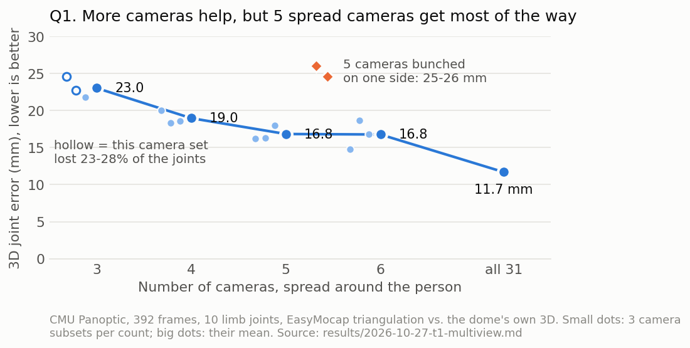
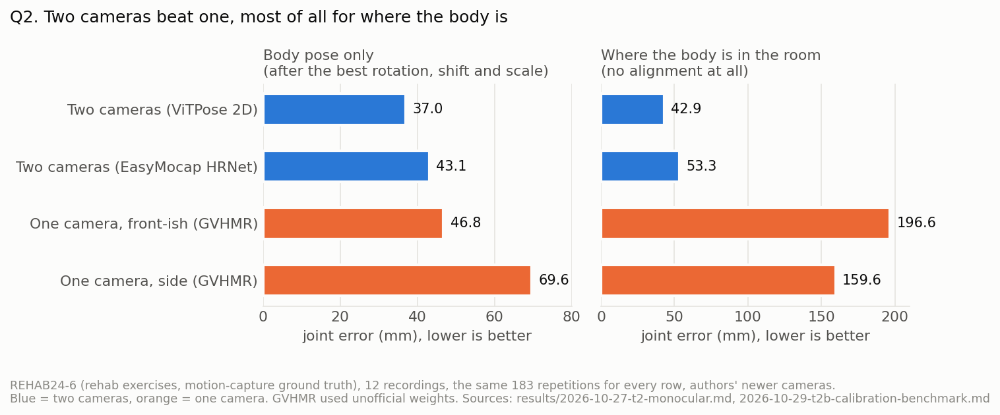
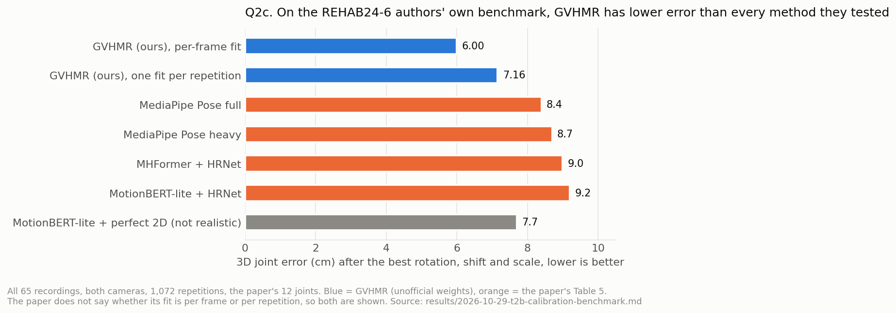
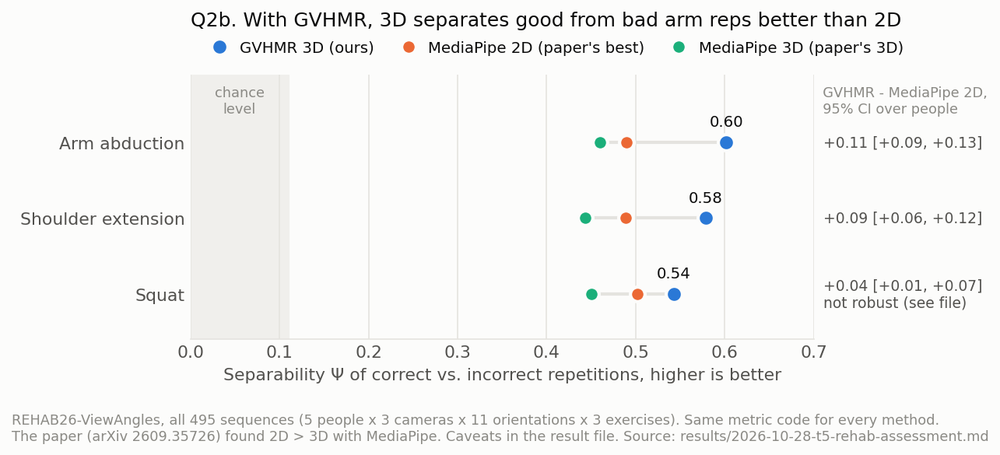

# Fall 2026 Research: Multi-view GoPro motion capture

Team workstreams: Hardware (Ahsan, Huy, Nghiem), Software (Danny, Katie), Calibration (Seishin), Reconstruction (Tan).

## Reconstruction results (updated 2026-10-29)

The reconstruction workstream asks one question: how well can a few ordinary cameras measure a person's 3D motion? This matters for two uses:
- **telemedicine:** checking rehab exercises;
- **telepresence:** building avatars.

Every result below comes from a public dataset that has ground truth, so each number is a measured error, not a demo. The runs used the school GPU server. Each result has its own file in [`reconstruction/results/`](reconstruction/results/), with the setup, commands, checks and what failed.

### Main findings

| Question | Answer so far | Evidence |
|---|---|---|
| **Q1. How many cameras do we need?** | <ul><li>5–6 cameras spread around the person: about **17 mm** average joint error.</li><li>All 31 cameras: 11.7 mm.</li><li>3 cameras: about 23 mm. Two of the three 3-camera sets also lost 23–28% of the joints.</li><li>5 cameras bunched on one side: 25–26 mm.</li><li>One camera a frame out of sync adds only 0.3 mm.</li></ul> | [T1](reconstruction/results/2026-10-27-t1-multiview.md), CMU Panoptic |
| **Q2. One camera or two, for rehab exercises?** | <ul><li>Two cameras: **43 mm** with no alignment at all.</li><li>One camera (GVHMR, a recent method): 47–70 mm even after the best possible alignment, and 160–200 mm off in where the body is in the room.</li><li>Main one-camera failure: in side view, the arm behind the body is hidden and gets guessed wrong.</li></ul> | [T2](reconstruction/results/2026-10-27-t2-monocular.md), [T2b](reconstruction/results/2026-10-29-t2b-calibration-benchmark.md), REHAB24-6 with motion capture |
| **Q2. How does a modern one-camera method compare with published results?** | <ul><li>On the REHAB24-6 authors' own benchmark (all 65 recordings), GVHMR's error is **6.0 cm**.</li><li>Their best method (MediaPipe) is at 8.4 cm.</li><li>Even a method given perfect 2D input is at 7.7 cm.</li></ul> | [T2b](reconstruction/results/2026-10-29-t2b-calibration-benchmark.md) |
| **Q2. Does better 3D help tell correct from incorrect repetitions?** | <ul><li>The same group's 2026 paper found that 2D beats 3D, using MediaPipe.</li><li>With GVHMR, 3D beats 2D on both arm exercises: separability Ψ +0.11 and +0.09, with 95% intervals above 0.</li><li>For the squat, the answer depends on how the angles are measured, so it is not settled.</li></ul> | [T5](reconstruction/results/2026-10-28-t5-rehab-assessment.md), REHAB26-ViewAngles |
| **Q3. Can we make a realistic avatar from one video?** | <ul><li>GaussianAvatar reproduced: 28.80 dB PSNR, against 28.83 for the authors' checkpoint. It renders at 38 fps.</li><li>On a phone video, most of the error comes from the body-pose estimates: 23.9 dB with the given poses, 29.4 dB once the test poses are corrected.</li><li>On our kind of data (one REHAB24-6 camera, 354 frames, 2 h training), the avatar looks right on seen views and through a 360° turn. On 3 held-out repetitions it scores only 18.5 dB with GVHMR's poses, against 28.1 dB once those poses are corrected. So the next thing to fix is pose accuracy, not the avatar.</li></ul> | [T4](reconstruction/results/2026-10-27-t4-gaussian.md), People-Snapshot, NeuMan, REHAB24-6 |
| **Q4. Can internet videos be used?** | Not started; this is a stretch goal. | [plan](reconstruction/EXPLORATION.md) |

"Joint error" is the mean distance between estimated and true joint positions. Ψ is the paper's score for how well correct and incorrect repetitions are told apart: about 0.1 is chance, and higher is better.

### Figures

All four figures are drawn from the numbers in the result files by [`make_summary_figures.py`](reconstruction/tools/make_summary_figures.py). They contain no dataset images.

### What is new compared with published work

The group that made REHAB24-6 (Masaryk University) has already published two relevant pieces of work:
- a dataset paper with a benchmark of 2D and 3D pose methods (SISAP 2024, and Information Systems 2025);
- a study of one camera vs. two cameras for exercise assessment, using MediaPipe (Jánošová et al., arXiv 2609.35726, 2026). It recommends one 2D camera.

Our results add:
- **A modern body-model method (GVHMR)** on both their benchmark and their assessment task. It has lower error than every method in their benchmark, and it separates correct from incorrect arm exercises better than their 2D baseline.
- **One camera vs. two cameras, scored in millimetres** against motion capture.
- **Camera count and sync on real multi-view data.** The previous estimates came from a simulation (Sep 29).
- **A check of the dataset's camera model.** The dataset ships no calibration. We recovered it from the data, and it matched the authors' own file exactly. Their newer camera estimate, sent to us on Oct 29, fits the video better, and it lowers our two-camera error from 47.5 to 42.9 mm.

### Caveats

- **GVHMR weights:** they come from an unofficial mirror, because the official download was blocked by a quota. Only one of the five files could be checked against an official copy.
- **Benchmark protocol:** the paper leaves three details unstated. We report both readings of the main one, and GVHMR is lower under both (6.00 or 7.16 cm, against 8.4).
- **REHAB26 baseline:** the paper's baseline is reproduced only approximately (80 of 90 cells within 20%). REHAB26 also has only 5 people.
- **Panoptic reference:** it is the dome's own 3D reconstruction, not motion capture.
- **Subjects:** all are healthy volunteers, not patients.

### In progress and next

- **Nov 3 meeting:** [summary of all results, with gaps and a slide outline](reconstruction/results/2026-10-29-summary.md).
- **Next experiments:**
  - fit a body model to the two-camera result and score it on the same benchmark;
  - give the avatar better poses (smooth GVHMR over time, or use both cameras to fix depth) and re-score it;
  - run GVHMR from two cameras for exercise assessment;
  - ask the REHAB authors for the evaluation details their papers leave out.

### Where to look

| Path | What it is |
|---|---|
| [`reconstruction/results/`](reconstruction/results/) | One file per experiment, with an [index](reconstruction/results/README.md) |
| [`reconstruction/EXPLORATION.md`](reconstruction/EXPLORATION.md) | The plan: questions Q1–Q4, datasets, tracks |
| [`reconstruction/server-prompts/`](reconstruction/server-prompts/) | The exact instructions each GPU-server session followed |
| [`reconstruction/tools/`](reconstruction/tools/) | All scripts used for the results |
| [`reconstruction/results/DATA_LOG.md`](reconstruction/results/DATA_LOG.md) | Every downloaded dataset and model, with license and checksum (none are in the repo) |
| [`reconstruction/research/CLAUDE_HANDOFF.md`](reconstruction/research/CLAUDE_HANDOFF.md) | Verified notes on the 14 links supplied at the start (2026-09-29) |

## Earlier setup work (Sep 29 – Oct 27)

| Stage | Status | Evidence |
|---|---|---|
| EasyMocap install, Windows CPU | Verified on Tan's laptop (2026-09-29) | [`SETUP_WINDOWS.md`](reconstruction/SETUP_WINDOWS.md) |
| Synthetic rig sweep (camera count, layout, 2D noise, sync) | Done (2026-09-29); reproduced exactly on the GPU server (2026-10-27) | [result](reconstruction/results/2026-09-29-synthetic-rig-sweep.md), [server setup](reconstruction/results/2026-10-27-server-setup.md) |
| 2D detection + 3D triangulation on real video (`zju-ls-feng`, 4 cameras, 50 frames) | Verified: reprojection median 5.65 px, p95 19.69 px | [`LOCAL_RUN_STATUS.md`](reconstruction/LOCAL_RUN_STATUS.md) |
| SMPL body fit + overlay video (same subset) | Verified on Tan's laptop (2026-10-27): 50 SMPL frames, mesh overlay on camera 1 | [`LOCAL_RUN_STATUS.md`](reconstruction/LOCAL_RUN_STATUS.md#smpl-fit--2026-10-27) |
| Reproduction on a second machine | Not done yet | [checklist](reconstruction/SETUP_WINDOWS.md#independent-reproduction-checklist-for-seishin) |

To reproduce on Windows, follow [`SETUP_WINDOWS.md`](reconstruction/SETUP_WINDOWS.md). [`SETUP.md`](reconstruction/SETUP.md) is the Linux guide; its install steps were verified in a cloud container on CPU. The environment, sample data, model weights and run outputs are not in the repo. The guides download them and list their SHA256 hashes.
