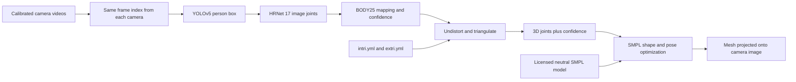

# EasyMocap: the exact local pipeline

Source inspected: upstream EasyMocap commit `e6006fd3814d5f8ad45a7ce965beb9bcc90767f2`.
Local entry point: `reconstruction/tools/local_cpu.py`. The runner uses the upstream
`config/mv1p/detect_triangulate_fitSMPL.yml` stages, with a pinned local YOLOv5
loader and explicit CPU/device, paths, frame range and output handling.

## Data flow

### 1. Videos and camera geometry

`myeasymocap/datasets/mv1p.py:MVDataset` reads camera folders and pairs the same
frame index across views. Intrinsics K describe the lens and pixel coordinates;
distortion parameters describe lens warping; extrinsics R and T transform world
coordinates into a camera frame. Projection uses `K [R | T]`.

The sample has supplied calibration. This experiment does not estimate camera
calibration or prove synchronization for a new hardware rig. A file at frame 20
must depict the same moment in every camera for triangulation to be meaningful.
The local runner extracts consecutive frames before selecting a step, because
the upstream dataset indexes a sorted image list rather than seeking frame IDs.

### 2. Person detection

`myeasymocap/backbone/yolo/yolo.py:BaseYOLOv5` runs an object detector on each RGB
image, selects the person class, and keeps the highest-confidence box. This is
a single-person pipeline. The detector cache is per camera and original frame.
The local `PinnedYOLO` adapter loads official YOLOv5 v7.0 and its `yolov5m.pt`
weights from disk rather than downloading whichever GitHub HEAD is current.

### 3. Image keypoints

`myeasymocap/backbone/hrnet/myhrnet.py:MyHRNet` uses HRNet-W48. Its superclass
crops and scales the box to a 288-by-384 input. Heatmap maxima give joint
coordinates; a small local gradient adjustment refines their locations.
The inverse affine transform maps crop coordinates back into original pixels.

`coco17tobody25` maps the 17 COCO joints into BODY25 slots. Neck and pelvis are
midpoints of shoulders and hips, with the lower endpoint confidence. The six
foot landmark slots stay zero. These are not 25 independently detected joints.
The saved arrays retain confidence, so missing feet must not be scored as real
observations or interpreted as body joints at the world origin.

### 4. Triangulation

`myeasymocap/operations/triangulate.py:SimpleTriangulate` first undistorts 2D
coordinates. Its iterative mode calls
`easymocap/mytools/triangulator.py:iterative_triangulate`, with a 25-pixel
reprojection threshold. Multiple camera rays constrain each joint's 3D position;
bad observations can be rejected instead of averaging incompatible rays.

The output is a `(25, 4)` array: XYZ and confidence. A successful skeleton can
exist without any SMPL model. The local runner saves these results in
`triangulated/`, fresh observations in `detections/`, and camera-view overlays in
`vis_repro/`. It does not read the sample's bundled OpenPose annotations.

Reprojection error asks how far projected 3D joints lie from the detector's 2D
joints. The local report compares only joint/view observations with both 2D and
3D confidence above 0.3. Its median and p95 are consistency diagnostics, not
ground-truth motion accuracy; systematic detector/calibration errors can still
produce a plausible fit.

### 5. SMPL fitting

This section describes inspected code; execution status is reported separately.

`myeasymocap/io/model.py:SMPLLoader` supplies a differentiable body model and a
BODY25 joint regressor. The local runner refuses `--fit` unless the user supplies
an existing licensed model, preventing the upstream missing-model auto-download.

The configured final stages use L-BFGS in this order:

1. `InitParams` creates pose, shape and global transform parameters.
2. `fitShape` fits limb lengths plus a shape regularizer.
3. `init_RT` aligns global rotation and translation from shoulder/hip joints,
   with temporal smoothing.
4. `refine_poses` jointly refines pose, translation and rotation, using 3D joint
   residuals, temporal smoothing and a Gaussian-mixture pose prior, repeated twice.

The parameters describe a skinned body surface rather than loose joint points.
They regularize noisy detections but cannot recover missing evidence reliably.
The prior and temporal terms can also hide a detector error in a plausible pose.

### 6. Rendering and evidence

`myeasymocap/io/vis3d.py:Render_multiview` produces model vertices, uses calibrated
camera geometry and renders the mesh onto real images through pyrender. The
local config explicitly selects image-overlay mode and camera 1. ffmpeg encodes
the frames at source FPS divided by the sampling step. Source images remain
available for inspection.

Do not call the full milestone complete until a run has actual SMPL parameter
files, decoded mesh-overlay frames and a playable overlay video. A skeleton
overlay is evidence for detection/triangulation only. A small subset is a smoke
test, not a completed run of all 23 cameras or the full sequence.

## Explain it aloud

“For each synchronized time step, we detect a person and 2D joints in every
camera. Calibration lets us triangulate those observations into a 3D skeleton.
We then optimize a parametric SMPL body to that skeleton across time, and project
its mesh back into the original images to inspect the result. Detector confidence,
camera calibration and synchronization all affect the reconstruction.”

Questions to be able to answer: Why does one camera leave depth ambiguous? Why
undistort before triangulation? Which BODY25 points are unavailable with COCO17?
Why is low reprojection error insufficient as an accuracy claim? What does SMPL
add beyond a 3D stick figure? Which exact stage fails if the model is absent?

References: [EasyMocap source](https://github.com/zju3dv/EasyMocap/tree/e6006fd3814d5f8ad45a7ce965beb9bcc90767f2),
[official quick start](https://chingswy.github.io/easymocap-public-doc/quickstart/quickstart.html).
